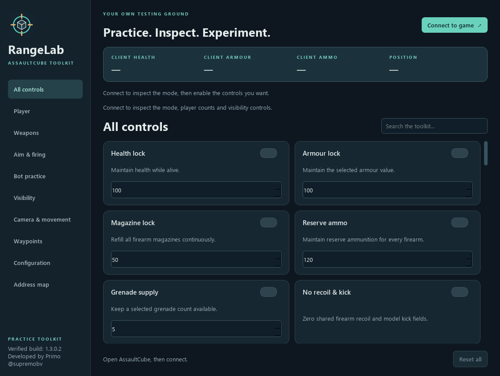

# RangeLab — AssaultCube practice trainer

A Windows desktop trainer and self-contained Cheat Engine table for the locally verified **AssaultCube 1.3.0.2 x86 executable**. Developed by **Primo ([@supremobv](https://github.com/supremobv))** for offline reverse-engineering practice.



## Native wall features

**Visibility → Animated model wall view** shows actual textured, animated player bodies through walls, including teammates. **Weapons → Through-wall shots** extends ordinary firearm targeting past map walls. Both are experimental, offline-only native patches, confirmed by Primo in an offline bot match. See [NATIVE-FEATURES.md](NATIVE-FEATURES.md). The external ESP remains separate.

## Get started from a fresh clone

The repository contains the source, logo/screenshots, generated CT table, tests and guides. Portable executables under `release/` are local build outputs and are not committed. Run from source or build a portable folder using the instructions below.

Requires Windows 10/11 x64 and Python 3.10 or newer with compatible dependency wheels. The development environment was tested with Python 3.14. The supported game is a separate installation; game binaries and assets are not redistributed.

```powershell
git clone https://github.com/supremobv/Assault-Cube-Trainer.git
cd Assault-Cube-Trainer
python -m venv .venv
.\.venv\Scripts\python.exe -m pip install -r requirements.txt
.\.venv\Scripts\python.exe rangelab.py
```

Runtime dependencies: PySide6-Essentials, pymem and pefile. Development dependencies add PyInstaller and lupa. The launcher requires either that project environment or a locally built portable folder.

## Basic operation

Double-click **Launch RangeLab.cmd**, or run **release\RangeLab\RangeLab.exe**. Keep the `_internal` folder beside the executable.

1. Open AssaultCube and start an offline practice level.
2. Click **Connect to game**. RangeLab checks the executable hash, player structure, and weapon references.
3. Choose a value, then enable a control. No controls turn on automatically.
4. Disable a control or click **Reset all** to restore its captured values. Disconnecting and closing also attempt restoration.

Use one trainer runtime at a time: disconnect RangeLab before enabling overlapping Cheat Engine scripts and uncheck CE entries before returning to RangeLab. Disable native controls and disconnect before restarting the game. One-time actions, shots, consumed ammunition and match scores cannot be undone by resetting settings.

## Configurations and appearance

Open **Configuration** to save/load JSON profiles and customize ESP boxes, names, health, armour and distance independently. Choose plus/dot/circle crosshairs, colors, size, gap and thickness; adjust ESP text/line sizes and radar pixel size. Fifteen appearance preferences are available. Aim options and numeric control presets are included in profiles.

Profiles live in `%LOCALAPPDATA%\RangeLab\profiles`. Loading does not enable controls by default. Optional activation skips multiplayer-incompatible controls. See **[CONFIGURATION-GUIDE.md](CONFIGURATION-GUIDE.md)** for profiles and the CT visual-preferences preset.

The new **Practice movement multiplier** is an offline W/A/S/D input multiplier that retains native collision physics. It does not increase the max-speed field. The **Visual ping label** only draws a custom overlay number; it changes neither latency nor the game's scoreboard.

## Reference source review

The linked rdbo reference targets AssaultCube **1.2.0.2** and explicitly labels its server-sided section as not working online. The current port remains for the verified **1.3.0.2** executable. Corresponding client and server damage paths were traced separately; their code running in a local process does not establish authority over the joined remote server.

See **[SOURCE-REVIEW.md](SOURCE-REVIEW.md)** for the function map and an honest status for every requested feature. Scope-mask removal, native fullbright, name/chat automation, item relocation, remote-player teleport and remote-server Godmode/Instakill are not implemented. Head aim does not guarantee every hit is a headshot. No linked DLL was executed or injected.

## Multiplayer compatibility

**Not every client-memory edit is a multiplayer feature.** RangeLab now uses the actual `connected` flag to distinguish a network server from a local game. It stops and marks server-dependent controls as offline-only, including health/armour, ammunition, weapon damage, magazine size, attack/reload timings, cooldown clearing, power-up supply, flight/hover and bot-stat edits. Those controls remain available in local practice.

ESP/radar, aim/firing automation, recoil/spread fields, camera controls and normal jump/crouch requests remain available as client-side controls. They still depend on valid targets, activation/focus and normal server rules. They do not provide server-side invulnerability or unlimited ammunition.

On connecting to a multiplayer game, RangeLab restores the exact stock weapon damage, magazine capacities, attack delays and reload durations for this fingerprint. It also stops incompatible controls if a server connection starts while the trainer is running. **Respawn once after this repair** to obtain fresh server health/ammo; the trainer does not substitute guessed health or ammunition. Stop overlapping CE freezes or older trainers first.

All HUD values are labeled **CLIENT**. See **[MULTIPLAYER-COMPATIBILITY.md](MULTIPLAYER-COMPATIBILITY.md)** for every control and reason, and **[MULTIPLAYER-DIAGNOSTICS.md](MULTIPLAYER-DIAGNOSTICS.md)** for the desynchronization investigation. No server bypass or modification of a joined server is implemented.

## Included controls

**47 controls total: 25 client-side controls available in multiplayer and 22 offline-only controls.**

The [complete compatibility table](MULTIPLAYER-COMPATIBILITY.md) lists all 47 controls and explains each offline restriction. Availability means the client-side control is enabled under normal game rules; it is not a guarantee that every server accepts its effects.

The full catalog includes:

- Health and armour locks.
- Firearm magazine and reserve-ammo locks.
- Grenade supply.
- Shared recoil/model-kick reduction.
- Shared spread-field reduction.
- Attack interval and reload duration.
- Hold-to-fire conversion and magazine capacities.
- Shared firearm damage, excluding shotgun.
- Camera FOV and scoped FOV.
- Gentler falling by resetting air time.
- Lock current yaw and pitch.
- Auto aim, head aim plus auto shoot, independent auto shoot, and crosshair trigger for bot practice.
- Stationary and low-health enemy bots.
- Akimbo availability, scope settling and scope lock.
- Reserve-fed refill, bunny hop and crouch hold.
- Target lock and nearest-target priority.
- Clear firing cooldown and stable-camera settings.

**12 distinct waypoint/loadout actions** (some shortcuts also appear in Aim & firing):

- Save a marker; return to it; clear it.
- Read coordinates; apply coordinates; lift by two units.
- Replenish health, armour, ammunition, and grenades once.
- Equip a selected primary firearm; equip the sniper directly; toggle its scope; face the nearest eligible player; level the camera view.

Shared weapon settings affect bots too. Some weapons use special calculations. The app does not claim that every possible trainer feature is implemented or that every gameplay effect has been individually confirmed. Maximum-speed editing is not included. Combat flight moves the player directly while retaining the normal combat state; visibility uses an external overlay.

## Automatic fire versus auto shoot

**Hold-to-fire conversion** repeats attack while you hold the left mouse button in the focused game. It also sets the shared automatic-fire flags. The assault rifle and SMG already fire automatically, so the difference is easiest to test with the carbine or pistol. The previous flag-only implementation did not drive the player's attack state; the new implementation does so while the trigger is held.

**Auto shoot** pulls the trigger for you while the activation key is held. The default is **Alt**. It does not aim, and it only uses firearms with ammunition. Release the activation key or move focus away from AssaultCube to stop.

**Crosshair trigger** fires only after an eligible bot is within the configured alignment tolerance. It does not rotate the view by itself.

## Auto aim and head aiming

1. Connect in an offline bot match and open **Aim & firing**.
2. Enable **Auto aim — players** for view steering, or **Head aim + auto shoot** for head targeting plus firing once aligned.
3. Focus the game and hold **Alt**. Activation can be changed to right mouse or always while the game is focused.
4. Face toward a bot so it enters the aim cone. **Face nearest player** can turn the view once to help acquire a target.

The aim cone is an angular distance from the crosshair, not a drawn overlay. Higher smoothing turns more gradually; smoothing 1 snaps to the selected angle. Range is measured in game-world units. Teammates are skipped by default in team modes; free-for-all is detected automatically.

Network players (`type == 0`) and local bots (`type == 1`) are eligible. Aim uses the game's rendered head tag and recent-render timestamp as a visibility filter. This is **not a complete map line-of-sight raycast**. Targets can be missed when head tags are unavailable, and brief occlusion transitions can still occur.

Head aiming is not a guaranteed kill or a change to hit registration. The sniper has a headshot damage bonus in this build; other weapons do not gain that bonus simply by aiming at the head. Spread, cover, timing, and target movement still matter. The head-aim mode includes its own firing, so head aim, independent auto shoot, and triggerbot are mutually exclusive fire modes. Auto aim/head aim also disable view lock, and enabling view lock disables aim steering.

Turning aim off leaves the camera at its current angle. Reset releases generated attack input and restores captured data settings; it does not undo shots, bot deaths, or score changes.

## How scoped FOV works

**Scoped FOV only applies to the sniper rifle while its scope is active.** It does not change an unscoped assault rifle's camera.

1. Use **Equip sniper** in Aim & firing or Waypoints.
2. In Camera & movement, set Scoped FOV to **20** and enable it.
3. Click **Toggle scope**, or use the game's normal scope input.
4. Check the context line: it should show **SCOPED · 20°**. Unscope to compare against normal camera FOV.

Lower values give a narrower view and stronger zoom; higher values show more of the scene. The original scoped default is 50°. The supported editor range is 5°–60°. This changes camera magnification; the game's existing mouse-sensitivity configuration remains in use.

## Combat flight, hover and visibility

**Noclip / combat flight** now retains normal alive state, so the game can still fire, reload and select weapons. Use **W/A/S/D**, **Space up**, **Ctrl down**, and **Shift for double speed**. The numeric value is movement speed in world units per second (1–50; default 16). These movement bindings are fixed for the trainer; normal weapon/mouse bindings remain the game's own. The controller updates position/interpolation data instead of entering editing state, and does not change the game's max-speed field or patch executable code.

**Disabling flight, Reset all and closing RangeLab return you to the entry point** if that player is still alive. Flight stops when that player dies or the player object changes. Disable it before changing maps; release/repress movement keys after disabling. It may jitter as normal physics runs between trainer updates, and a multiplayer server can correct the position. Flight is now unavailable while connected to a network server.

**Hover** holds your current eye height with ordinary horizontal collisions. Hover, flight and bunny hop exclude one another.

Open **Visibility** for player ESP, radar, teammates, tracer lines, center crosshair, an aim-cone guide and off-screen bearings. ESP's numeric value is maximum distance (default 250 units); radar's is its radius (default 75). The cone guide is an angular approximation and is capped at 80° for drawing very wide cones. It does not enable aim by itself.

Visibility and aiming now enumerate both **network player entities and local bots**, excluding the local player and camera objects. **Team modes** hide teammates by default; **free-for-all** treats all opponents as enemies regardless of stored team number. Include teammates enables mint markers for allies; opponents are orange. Dead/spectating entities are omitted. Aim retains its activation, recent-render and head-tag filters. Bot health/armour, low-health and stationary-bot edits remain limited to local bot entities.

Use a **windowed or borderless first-person view**. The external overlay hides on focus loss and can be hidden by exclusive fullscreen. Spectator/death cameras are not tracked; respawn for correct alignment. ESP uses body origins and eye height, so its boxes approximate body outlines and work behind walls without stale head tags. Radar and edge bearings are horizontal and do not show map geometry. The status line reports the detected mode, player/bot counts, eligible targets, enabled visibility controls and overlay errors.

Multiplayer visibility uses data available in your game client. Displayed remote health can be stale or incomplete. **Health, ammunition, damage and other gameplay edits can be overridden by the server**; changing a local field does not establish a server-side effect.

## Practice targets

**Practice bot health** and **Practice bot armour** maintain the selected values on eligible living local bots. Bot-health lock and low-health bots are mutually exclusive. Their team filter now follows the actual game mode, so free-for-all does not incorrectly skip bots with the same team number. Disabling restores captured fields when their entity still exists.

## Restart reliability

Player fields use the pointer stored at **`ac_client.exe + 0x18AC00`**, resolved again as the trainer runs. Health is at `[root] + 0xEC` and armour at `[root] + 0xF0`.

During the full restart test, the process changed from PID 8516 to PID 5644 and the player object moved from `0x0066D448` to `0x009179F0`. The same module-relative root resolved the new player object successfully.

This is a stable pointer path for the tested build, not a promise that every heap address remains numerically unchanged. The app checks this exact SHA-256:

```text
5b588e6ff7710fa0170553506a50bfa14750ccb438a154e4ea0e0b1ba621cefb
```

See **[ADDRESS-MAP.md](ADDRESS-MAP.md)** for offsets, data types, discovery notes, test evidence, and versioned source references.

## Cheat Engine table

Open **AssaultCube-1.3.0.2.CT** in Cheat Engine, then attach Cheat Engine to the current `ac_client.exe` process. A game restart creates a new process, so reattach afterward.

The table includes 47 opt-in trainer entries, Reset all and Visual preferences actions, and player fields, attack input, ammo/cooldown arrays, camera globals, sniper scope state, bot-vector slots, and shared settings for all nine weapon definitions. Expand a group to inspect or edit fields. Check a value's box to freeze it manually. Empty bot slots can display `??`; RangeLab performs entity validation that manual table entries do not.

- The table has no startup Lua or automatic edits on loading. Opt-in trainer checkboxes run embedded Lua only when enabled. The two native wall controls install reversible game-memory patches; ordinary overlay controls remain external.
- Trainer scripts check the known executable MD5 and layout. Manual address records do not enforce that guard.
- Trainer script snapshots restore captured values on disable; ordinary manual CE edits do not participate in that reset system.
- Avoid having CE and RangeLab freeze the same field simultaneously.
- Selected weapon ID is labeled for inspection; changing it alone does not synchronize weapon-object references.

See **[CT-TRAINER-GUIDE.md](CT-TRAINER-GUIDE.md)** for checkbox usage, presets, reset behavior and testing limits. Use the app or CE trainer controls one at a time.

## New practice controls

- **Keep akimbo available** maintains the power-up flag and expiry; use pistol selection to activate akimbo.
- **Instant scope settling** removes the sniper accuracy-settling wait.
- **Keep sniper scoped** maintains scope state while the sniper is selected.
- **Reserve-fed refill** consumes reserves to refill an empty magazine and skips the reload animation; it is mutually exclusive with ammo locks. These ammo transfers are not reversed by Reset all.
- **Bunny hop** repeats the normal jump request while Space is held and the player is grounded in the focused game.
- **Crouch hold** maintains the crouch request and restores it on disable.
- **Keep current target** retains an eligible target until it leaves the filters.
- **Nearest-target priority** prefers distance over crosshair proximity inside the aim cone.
- **Level view** resets pitch and roll once.

## Validation

Health and ammo had **HUD confirmation** from the user, and ammo consumption was checked while firing. The original 16 toggles passed **live field write/read-back/restoration checks** after the game restart. Other gameplay effects remain subject to individual testing.

The live lift/return-to-marker check changed Z and returned to the captured position. Replenish-loadout values were checked and restored after the test.

The current suite passes **85 offline tests**, including feature parity between the app and CT, Lua-runtime presets, profile validation/persistence, multiplayer transitions, native patch rollback and exact Python/Lua machine-code parity. Separate live tests using a controlled activation adapter produced repeated carbine shots (10→7 rounds with auto shoot; 10→8 with hold-to-fire), acquired a bot and changed view angles, and verified scoped state at 20° FOV. A sniper head-aim run used two rounds while local frags increased from 10 to 14, consistent with two headshot kills. These firing tests changed match score/bot state naturally; loadout settings and view angles were restored afterward. Actual hotkey and focus-loss behavior is covered by controlled-input tests; verify your preferred activation in the game.

The test suite covers fake-memory restoration, root changes, stale heap addresses, failed writes, dead-player checks, coordinate validation/interpolation, UI state and search, and CE-table structure. It never attaches to a real game.

Raw temporary test values were restored. Continuous modifications are off at startup. Position/loadout actions are one-time changes and are not undone by Reset all. Clear/resave waypoints after changing maps.

## Source run and build

Requires Windows 10/11 x64 and Python 3.10 or later. A 64-bit trainer controls the supported 32-bit game process.

```powershell
python -m venv .venv
.\.venv\Scripts\python.exe -m pip install -r requirements.txt
.\.venv\Scripts\python.exe rangelab.py
```

Run offline tests and regenerate artifacts (development dependencies include the Lua test runtime):

```powershell
.\.venv\Scripts\python.exe -m pip install -r requirements-dev.txt
.\.venv\Scripts\python.exe -m unittest discover -s tests -v
.\.venv\Scripts\python.exe export_ce_table.py
.\.venv\Scripts\python.exe export_compatibility.py
.\.venv\Scripts\python.exe render_preview.py
```

Build a portable folder:

```powershell
powershell -ExecutionPolicy Bypass -File .\build.ps1
```

The script installs build dependencies, runs tests, regenerates the table/icons/previews, and packages `release\RangeLab`. Python and Qt are included in that portable folder.

## Implementation and limits

- `engine.py` — fingerprint checking, pointer resolution, field changes, snapshots, worker loop, and waypoint/loadout actions.
- `native_features.py` / `ce_native.lua` — reversible exact-build native patches, x86 OpenGL checks, paused updates and restoration.
- `profile.json` — exact build hash, module-relative offsets, field layouts, and restart evidence.
- `rangelab.py` — Qt interface with categories, search, telemetry, and address view.
- `profile_store.py` / `configuration_ui.py` / `visual_settings.py` — validated profiles, independent ESP components and appearance.
- `compatibility.py` / `export_compatibility.py` — shared multiplayer capability rules and reference generator.
- `modes.py` — mode names and team/free-for-all filtering.
- `overlay.py` / `vision.py` — external overlay lifecycle and perspective/radar geometry.
- `ce_visuals.lua` — CE-local transparent overlay and Windows window-placement APIs.
- `aiming.py` — angle geometry and target filtering independent of memory access.
- `catalog.py` — shared app/CT feature definitions.
- `ce_runtime.lua` — embedded, opt-in CE feature runtime.
- `export_ce_table.py` — trainer-script and manual-address CE table generator.
- `tests/` — offline engine, UI, and table checks.
- `research/` — local discovery notes and verification results; downloaded source and raw dumps are excluded by `.gitignore`.

The worker re-resolves the player root every tick. It captures original field bytes, keeps failed restoration snapshots for retry, and does not restore old heap addresses after the player pointer changes. A write error pauses further automatic writes until reset/reconnection. The game may naturally change a value after restoration.

The two native wall controls patch executable memory and execute a small render-thread wrapper when explicitly enabled. Other controls retain their previous data/overlay design. There are no injected threads, kernel drivers, Windows security changes, or anti-cheat bypasses. The trainer does not elevate itself. If access is denied, check the game/trainer privilege levels rather than disabling antivirus.

The original executable is not redistributed. AssaultCube and its source belong to their respective authors; source links are provided in the address map. This independent trainer is intended for local practice with a build you control.

New Lua-runtime live checks confirmed health restoration, akimbo availability, scope lock/settling, reserve-fed ammo transfer, crouch eye-height changes, and a jump Z increase. They used a CE-compatible API adapter; native CE UI/timer behavior remains unverified.


The multiplayer fix was checked against a live Capture the Flag client: its entity vector contained network players (`type 0`) and no local bots. Read-only snapshots now include eligible opponents. An earlier 57-test suite covered network-player enumeration, team/free-for-all mode changes, excluding the local player/cameras, bot-only writes, and firing/weapon selection in combat flight. Combat flight's gun compatibility is tested with simulated memory/input; live firing and movement still need confirmation in a local practice match. Native CE checkbox/timer/overlay behavior remains unverified.

An earlier 78-test suite covered blocking the original 20 offline-only controls, actual-connection detection independent of game mode, stopping edits on joining a server, stock weapon repair without invented player health/ammo, and app/CE parity. The live connection flag was 1 in the joined Capture the Flag session. After the previous trainer closed cleanly, sniper stock values read back as 5 rounds and 1500 ms. Player health/ammo still require a normal authoritative respawn; this check did not test server-side invulnerability or accepted hits.

The current extension passes 85 tests, including atomic profile persistence, invalid/malicious profile rejection, non-activating profile load, compatible activation, visual preferences, movement-input release, and CT appearance preset execution. Practice speed was checked with simulated memory/input; live physics and native CE renderer behavior remain subject to confirmation.

The two native wall controls bring the catalog to 47 and the offline-only count to 22. A corrected live 90-second trial completed and restored all original bytes. Primo confirmed real animated bodies through walls and successful through-wall bot damage. The current suite has 85 passing tests; native CE UI remains unverified. See NATIVE-FEATURES.md for the initial crash/fix and remaining limits.

## Troubleshooting

| Symptom | Check |
| --- | --- |
| Unsupported executable | Compare the installed EXE hash with the fingerprint above. Another game build needs a separately verified profile. |
| Cannot connect or access denied | Start `ac_client.exe` first and check privilege compatibility. RangeLab does not elevate itself automatically. |
| Aim or repeated fire does nothing | Focus the game, use a living player with a firearm, hold the configured activation key, and check target filters, ammunition and normal cooldowns. |
| Scope FOV seems unchanged | Equip the sniper and actually scope in. This changes zoom, not the scope mask. |
| ESP missing or misaligned | Use windowed/borderless first-person play, focus the game and check the status line. Respawn if dead or spectating. |
| Native code mismatch or restore conflict | Stop overlapping trainers and CE freezes, retry Reset all, or restart the game. Native restoration refuses to overwrite unexpected third-party changes. |
| Health reads 999 but player dies online | The number is client memory; it does not establish server invulnerability. These locks are offline-only. |
| CE Lua or AA error | Record the exact entry and error. Native CE checkbox/assembler/timer/overlay integration remains unverified. |
| Portable EXE fails after copying | Keep the entire portable directory, especially `_internal`, alongside `RangeLab.exe`. |

## Ownership and credits

RangeLab is developed for and owned by **Primo / @supremobv**. Third-party dependencies retain their respective licenses. AssaultCube and its game assets belong to their original authors. The original game is not redistributed here; consulted reference sources and version-specific findings are attributed in [SOURCE-REVIEW.md](SOURCE-REVIEW.md) and [ADDRESS-MAP.md](ADDRESS-MAP.md).

Documentation index: [Configuration](CONFIGURATION-GUIDE.md), [Cheat Engine](CT-TRAINER-GUIDE.md), [Native wall features](NATIVE-FEATURES.md), [Multiplayer compatibility](MULTIPLAYER-COMPATIBILITY.md), [Diagnostics](MULTIPLAYER-DIAGNOSTICS.md), and [Source audit](SOURCE-REVIEW.md).
